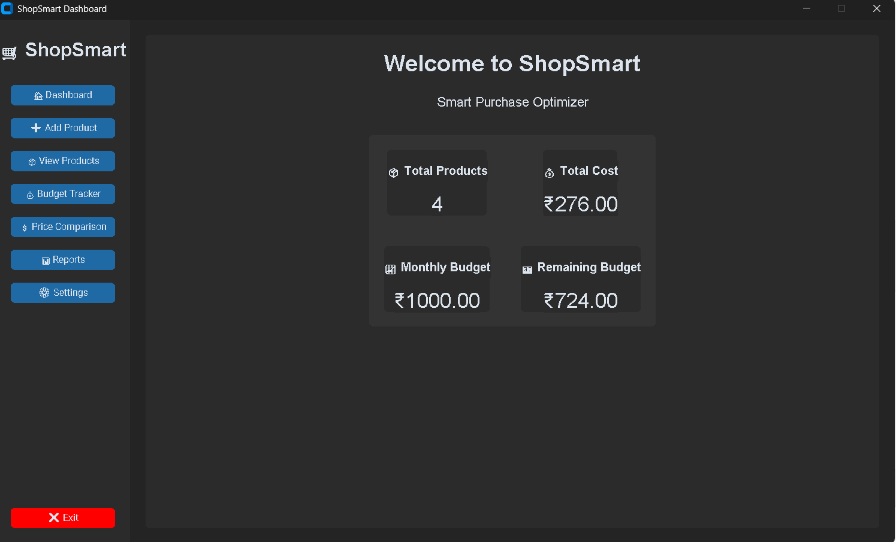

# 🛒 ShopSmart – Smart Purchase Optimizer

ShopSmart is a Python-based desktop application designed to help users manage their products, track expenses, monitor budgets, and compare prices across different stores.

The application provides a simple graphical interface that makes shopping management easier and helps users make better purchasing decisions.

## 📌 Abstract

ShopSmart – Smart Purchase Optimizer is a desktop-based application developed using Python and CustomTkinter. It allows users to maintain product details, calculate total spending, set monthly budgets, generate expense reports, and compare product prices from different stores.

The application stores product and budget information using JSON files, making data management simple and convenient.

## 🎯 Objectives

* To simplify product management.
* To track shopping expenses.
* To monitor monthly budgets.
* To compare product prices across stores.
* To identify the cheapest available option.
* To help users make cost-effective purchasing decisions.

## ✨ Features

### 1. Login System

* Simple login interface.
* Demo login credentials.

### 2. Dashboard

* Displays total number of products.
* Shows total shopping cost.
* Displays monthly budget.
* Calculates remaining budget.

### 3. Product Management

* Add new products.
* Enter product name, category, store, price, and quantity.
* View saved product details.

### 4. Budget Tracker

* Set a shopping budget.
* Calculate total spending.
* Display remaining budget.
* Show budget usage progress.

### 5. Price Comparison

* Search for products.
* Compare prices across different stores.
* Display the lowest-priced option.
* Calculate potential savings.

### 6. Reports

* Display total products.
* Calculate total quantity.
* Show total spending.
* Display category-wise spending.

### 7. Settings

* Change application appearance.
* Choose Dark, Light, or System mode.
* View application information.
* Reset application data.

## 🛠️ Technologies Used

| Technology    | Purpose                    |
| ------------- | -------------------------- |
| Python        | Application development    |
| CustomTkinter | Graphical User Interface   |
| JSON          | Data storage               |
| Matplotlib    | Data visualization library |
| Pillow        | Image handling             |
| VS Code       | Development environment    |

## 📂 Project Structure

```text
ShopSmart/
│
├── assets/
│   └── icons/
│
├── screenshots/
│
├── main.py
├── login.py
├── dashboard.py
├── product.py
├── budget.py
├── report.py
├── price_comparison.py
├── storage.py
├── gui.py
│
├── products.json
├── budget.json
├── requirements.txt
└── README.md
```

*Note: `products.json` and `budget.json` are used for storing application data. They may be created automatically when the application runs.*

## ⚙️ Installation and Execution

### Step 1: Clone the Repository

```bash
git clone YOUR_GITHUB_REPOSITORY_URL
```

### Step 2: Open the Project Folder

```bash
cd ShopSmart
```

### Step 3: Create a Virtual Environment (Optional)

```bash
py -m venv .venv
```

### Step 4: Activate the Virtual Environment

```bash
.venv\Scripts\activate
```

### Step 5: Install Dependencies

```bash
py -m pip install -r requirements.txt
```

### Step 6: Run the Application

```bash
py main.py
```

## 🔐 Demo Login Credentials

| Field    | Value    |
| -------- | -------- |
| Username | admin    |
| Password | admin123 |

**Note:** These are demonstration credentials for the current application, not production-secure authentication.

## 📸 Screenshots

Add screenshots of your application inside the `screenshots` folder.

Suggested screenshots:

* Login Screen
* Dashboard
* Add Product
* View Products
* Budget Tracker
* Price Comparison
* Reports
* Settings

Example:

```markdown

```

Replace the image filenames with the actual names of your screenshots.

## 🚀 Future Enhancements

* Secure user authentication.
* Export reports to PDF and Excel.
* Graphical expense analysis.
* Cloud-based data storage.
* Product recommendation system.
* Mobile application support.

## 👨‍💻 Developed By

**ShopSmart – Smart Purchase Optimizer**

Developed as an academic project using Python.

---

⭐ If you find this project useful, consider giving the repository a star!
